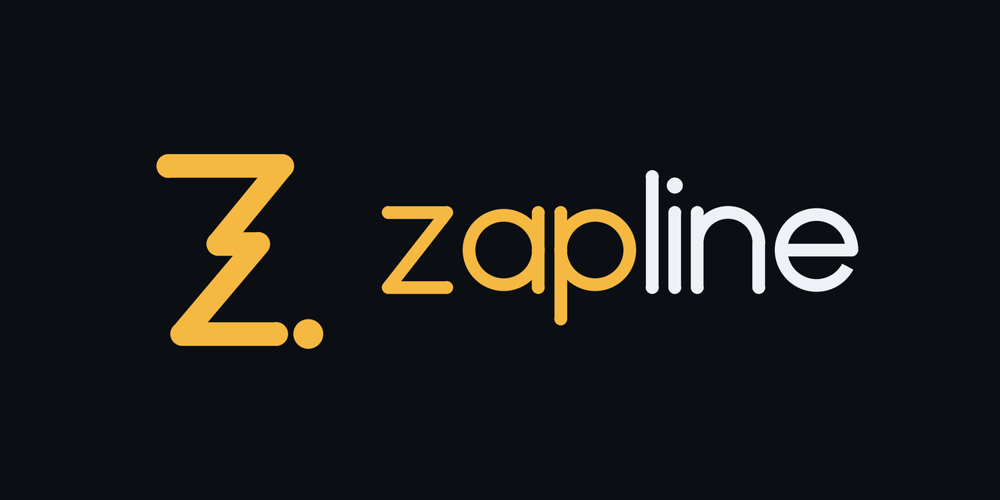

# Zapline



A free, open-source IPTV player for TV, phone, desktop and web.

Zapline plays **your own** sources: Xtream-compatible logins, M3U/M3U8 playlists
and Stalker portals, with XMLTV guides. Every feature is free: multiple
sources, multiple guides, catch-up, favourites. No account, no ads, no
paywall.

> **Zapline does not provide any content.** It ships with no playlists,
> channels or links, and the project does not endorse any provider. You are
> responsible for the legality of the sources you add.

> The name still needs a formal trademark search before the first store release.

## Status

Phase 1 (MVP) in progress. See [docs/ROADMAP.md](docs/ROADMAP.md).

## Targets

| Platform | Status |
|---|---|
| Android TV, Fire OS (Fire TV Stick 4K/4K Max, Cube) | planned for MVP |
| Android phones and tablets | planned for MVP |
| Windows, macOS, Linux | planned for MVP |
| iOS | after licence review of the video stack |
| Web (lite) | phase 3 |
| tvOS, Fire TV on Vega OS, Tizen, webOS | under evaluation |

## Repository layout

```
apps/zapline/          Flutter app (TV, mobile, desktop)
packages/zapline_core/ Pure Dart core: M3U, Xtream-compatible API, XMLTV,
                      EPG matching, catch-up URLs
packages/zapline_data/ SQLite storage, source sync, backup format
tools/mock_panel/     Local Xtream-compatible test server (demo/demo)
packaging/            Flatpak, winget and desktop metadata
docs/                 Architecture, roadmap, releasing
```

`zapline_core` has no Flutter dependency and can be reused by other clients.

## Development

Requires the Flutter SDK (stable channel).

```sh
dart pub get                      # resolves the whole workspace
dart test packages/zapline_core    # core unit tests
cd apps/zapline && flutter run     # run the app
```

## Releasing

See [docs/RELEASING.md](docs/RELEASING.md).

## Contributing

See [CONTRIBUTING.md](CONTRIBUTING.md). Contributions are accepted under the
MIT licence with a Developer Certificate of Origin sign-off.

## Licence

[MIT](LICENSE). The name and logo are covered by the
[trademark policy](TRADEMARK.md).
